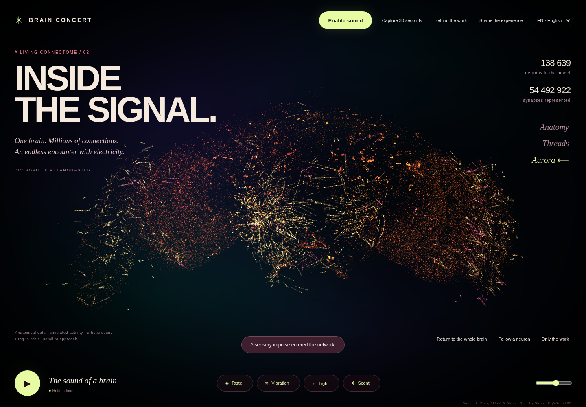

# Brain Concert — Inside the Signal

**Real wiring. Simulated activity. Artistic sound.**

An interactive fruit fly connectome, simulated, visualized and sonified entirely in your browser. Adapted from the Aivokonsertti artwork.



- **138,639 neurons** and **15,091,983 directed connection records**, representing **54,492,922 synapses**.
- WebGPU leaky integrate-and-fire simulation, Three.js visuals and procedural Web Audio.
- Sensory stimulation, neuron inspection and silencing, network ablations and event export.
- English by default, with an optional Finnish translation. Sound starts muted.
- No compute backend, analytics, external fonts or prerecorded soundtrack.

[Try the original live artwork](https://koodio.fi/demot/aivokonsertti/) · [Data and provenance](docs/DATA.md) · [Model and limitations](docs/MODEL.md) · [Credits](CREDITS.md)

## Run locally

Requires **Node.js 22.20+ (22.x) or 24.12+**, npm, and a current WebGPU-capable browser with hardware acceleration. Recent Chrome or Edge is a useful starting point; support depends on your operating system, GPU and browser configuration. The full network is demanding on memory and graphics resources.

```sh
git clone https://github.com/Resnais-Beefhair/brain-concert.git
cd brain-concert
npm ci
npm run data:fetch
npm run dev
```

Open the localhost URL printed by Vite (normally `http://127.0.0.1:5173/`). The first data download expands to approximately **132 MB**. Downloads are checked against the versioned SHA-256 manifest. Already verified files are reused.

The dataset is **not stored in Git**. The initial download uses the existing public artwork as an artifact mirror, not as a computation service. After setup, the application works without external runtime requests. See [alternative mirrors and rebuilding from source](docs/DATA.md).

Do not open `index.html` using `file://`. WebGPU requires a secure context: localhost for development or trusted HTTPS for remote access. An ordinary LAN HTTP address is not sufficient.

## Controls

- Drag to orbit; scroll to zoom.
- **Enable sound** to listen; the application never starts audio automatically.
- **1–4** send taste, vibration, light and scent impulses. **Space** pauses.
- **H** hides controls; **Esc** brings them back.
- **Follow a neuron** searches by cell type or exact FlyWire ID.
- **Shape the experience** changes sensory input, timbre, colour and visual quality, or disconnects synapses and silences the network.
- **Capture 30 seconds** exports WebM where the browser supports recording.
- Background tabs pause. Visual FPS and model-time speed are separate measurements.

## Build and test

```sh
npm run data:verify
npm test
npm run build
```

Serve the resulting `dist/` directory on localhost or static HTTPS. Keep the `data/` and `licenses/` directories. Correct JavaScript/CSS MIME types are required. For transfer efficiency, enable HTTP gzip/Brotli on the server; this checkout does not include the original host-specific deployment configuration.

[Verification instructions](docs/TESTING.md) cover browser interaction, failure paths, CPU/GPU reference fixtures and full-network ablation tests. [Embedding](docs/EMBEDDING.md) describes the visual module's integration boundary.

## What this is — and is not

The measured wiring constrains a simplified simulation. Simulated spikes drive the visual events and selected musical notes; musical scales, timbres and visual paths are authored interpretations. Anatomical points are **anchors**, not complete neuron morphologies or guaranteed soma locations.

This is not measured activity from a living animal, not a biologically validated whole-brain behavioural replica, and not evidence that a fly composes music. The project has not yet compared its dynamics with suitably randomized control networks. It is an artwork and an inspectable experimental starting point.

## Repository layout

```text
src/                  Browser application, GPU model, sound and visuals
tests/                Unit tests and a small CPU reference model
tools/                Dataset setup, raw-data conversion and browser/GPU checks
data/                 Pinned manifest and sensory seed IDs (small, versioned)
public/data/          Downloaded/generated full dataset (ignored by Git)
public/licenses/      Third-party notices and data attribution
docs/                 Model, provenance, integration and verification guides
```

## License

The original application code and documentation are released under the [MIT License](LICENSE), copyright 2026 Resnais-Beefhair and contributors.

The FlyWire connectivity and archived annotation data remain **CC BY 4.0**; they are not relicensed under MIT. Upstream model code and software dependencies retain their own notices. See [credits](CREDITS.md) and [third-party and data licenses](public/licenses/).

## Contributing and releases

[Contributing](CONTRIBUTING.md) · [Security](SECURITY.md) ·
[Community guidelines](CODE_OF_CONDUCT.md) · [Changelog](CHANGELOG.md) ·
[Release guide](docs/RELEASING.md) · [Audit decisions](docs/AUDIT-2026-10-12.md)

**Copy settings link** in the settings drawer shares sensory weather, timbre,
model-time speed, colour, view mode and optionally a selected neuron. It starts
fresh activity with sound off; it is not a replay of a neural state.
